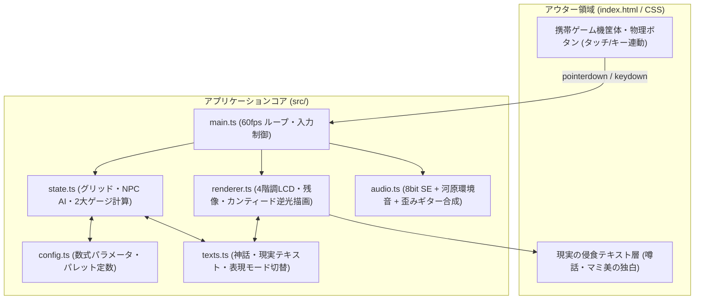

# 『FIRE STARTER』実装計画書 (Implementation Plan)

> [!IMPORTANT]
> **コア・フィロソフィー（絶対制約）**
> 1. **「勝利」や「ステージクリア」を一切実装しない**: 「日常への埋没（閉塞度100%）」「自己破滅（焼失率100%）」「補導（警察接触）」の3つのバッドエンドに至るまで、ギリギリの均衡を保ち続ける無限ループ構造とする。
> 2. **爽快感よりも「焦燥感」と「けだるさ」を優先**: 派手なスコア演出や明るい色彩を排し、1999年当時の反射型モノクロ〜オリーブ液晶（4階調）と夕暮れの河原の空気感を再現する。
> 3. **外部アセットゼロ**: 画像・音声ファイルは一切使わず、HTML5 Canvas + Web Audio API によるプロシージャル生成のみで完結させる。

---

## 1. アーキテクチャ＆ディレクトリ構成

Vite + Vanilla TypeScript 構成でセットアップし、PC・スマートフォンの両方からブラウザで即座にプレイ可能、かつ GitHub Pages で自動公開できる構成とします。



### ファイル一覧
- `package.json` / `tsconfig.json` / `vite.config.ts` (`base: './'` 設定)
- `.github/workflows/deploy.yml` (GitHub Pages 自動デプロイ設定)
- `index.html` (二重構造UI：夕暮れの河原背景＋携帯ゲーム機ベゼル＋物理ボタン＋字幕レイヤー)
- `src/config.ts` (4階調パレット、セル耐久値、ゲージ変動係数、アイテム性能、NPCパラメータ)
- `src/texts.ts` (神話ナレーション、現実世界の侵食テキスト、3種バッドエンド、表記モード対応データ)
- `src/state.ts` (`28×18` グリッド管理、建築増殖、延焼シミュレーション、消防士・警察官AI、ゲージ計算)
- `src/renderer.ts` (ドットマトリクス描画、液晶残像処理、カンティード顕現シルエット演出)
- `src/audio.ts` (Web Audio API プロシージャル音響：ボタン打鍵音、8bit SE、せせらぎ・サイレン、ディストーションギター)
- `src/main.ts` (ゲームループ、キーボード・マウス・スマホタッチ `pointerdown`/`pointerup` 統合制御)

---

## 2. 「クリアが存在しないジレンマのバランス」のコード設計 (`src/state.ts`, `src/config.ts`)

### 2.1 マップ構造（28×18 = 504セル）
- **川 (`RIVER`: 64セル)** と **幹線道路 (`ROAD`: 120セル)** を固定配置し、残りの **可燃・建築可能領域 $N_{\text{total}} = 320$ セル** を街の母数とします。
- 各区画は `EMPTY` → `BUILDING_1` (重み1.0) → `BUILDING_2` (重み1.5) → `BUILDING_3` (重み2.5) と時間経過で自動的に増殖・肥大化します。

### 2.2 閉塞度 ($S$) と焼失率 ($D$) の相反ダイナミクス
毎フレーム（経過時間 $dt$ 秒）、以下の微分方程式ベースの数式で2つの致死ゲージを更新します。

1. **閉塞度（SUFFOCATION: $S \in [0, 100]$、初期値 $40\%$）**
   $$\Delta S / dt = +0.8 + \left(\frac{\sum w_i \cdot \text{Building}_i}{N_{\text{total}}}\right) \times 3.5 - N_{\text{burning}} \times 0.45$$
   - **ジレンマ設計**: 何もしなければ毎秒 $+0.8\% \sim +4.3\%$ のペースで息苦しさが上昇し、約20〜30秒で $S = 100\%$（日常への埋没エンド）に達します。閉塞度を下げる唯一の手段は、常に2〜5区画以上を同時燃焼（$N_{\text{burning}} \ge 3$）させ続けることです。

2. **焼失率（DESTRUCTION: $D \in [0, 100]$、初期値 $0\%$）**
   $$D = \frac{N_{\text{burning}} + N_{\text{ash}}}{N_{\text{total}}} \times 100$$
   - **ジレンマ設計**: 燃え尽きたセルは `ASH`（焼け跡）となり、**25秒間** は焼失率 $D$ を押し上げ続けます。25秒経過すると瓦礫が撤去されて `EMPTY` に戻り、再び建物が増殖し始めます。
   - **エスカレーションの罠**:
     - 序盤（マッチ・ライター）は火力が弱く、増え続ける消防士にすぐ消火されるため、閉塞度 $S$ がじわじわ上がって焦燥感を生みます。
     - 中盤以降（Day 4 火炎瓶・Day 6 爆弾）は一気に閉塞度を下げられますが、周囲への延焼確率が $40\% \sim 65\%/\text{秒}$ に跳ね上がるため、連鎖的な延焼が起きて $D = 100\%$（自己破滅エンド）へ暴走しやすくなります。

---

## 3. 「4階調LCDの残像感」と「カンティード逆光シルエット」の描画設計 (`src/renderer.ts`)

### 3.1 4階調LCDパレットと残像（Ghosting）の表現
論理サイズ `224 × 144` px のオフスクリーン（またはスケーリングCanvas）に対し、毎フレーム `clearRect` を使わず、**最明色 `COLOR_0 (#8b956d)` を不透明度 `0.35` で全面に塗り重ねる**ことで、1999年当時の反射型液晶特有の「ドットが尾を引く残像感」を再現します。

```typescript
// 1. 毎フレームの残像クリア（完全消去せず前フレームを35%ずつ減衰）
ctx.fillStyle = 'rgba(139, 149, 109, 0.35)';
ctx.fillRect(0, 0, 224, 144);

// 2. セル・NPC・プレイヤー・黒き炎を4階調パレットで8x8ドット描画
// COLOR_0: #8b956d, COLOR_1: #6b744e, COLOR_2: #3e442b, COLOR_3: #1b1e12

// 3. 仕上げに1px単位の液晶グリッド線をオーバーレイ
ctx.fillStyle = 'rgba(27, 30, 18, 0.12)';
// 縦横1pxおきに薄いドット境界線を描画
```

### 3.2 カンティード（黒き炎の神）顕現時の逆光シルエット描画
絶体絶命状態（$S \ge 80\%$ または $D \ge 80\%$ または周囲3マス以内に警官・消防士3体以上）で `PRAY [START / C]` を押した瞬間、3.5秒間の特別演出シーケンスへ突入します。

1. **フェーズ1（0.0s〜0.4s：液晶の破壊と反転フラッシュ）**
   - 4階調の制約を突破し、高コントラストな白 (`#f4f6e8`) と漆黒 (`#0a0b08`) で画面全体を激しく反転フラッシュさせながら、画面中央から放射状の「液晶ひび割れライン」をプロシージャル描画します。
2. **フェーズ2（0.4s〜3.0s：逆光シルエットと黒い火の粉）**
   - 背景を眩しい逆光色 (`#f4f6e8`) で塗りつぶし、画面中央にベクター＆ドット合成で以下のシルエットを漆黒 (`#0d0e0a`) で描画します：
     - **頭部**: パースのついたレトロなブラウン管テレビ型ヘッド（画面部分にだけ白いスリット光）
     - **翼（マント）**: 左右へ画面いっぱいに広がる、端がボロボロに裂けた巨大な黒いマントのシルエット（サイン波でゆっくり羽ばたくように揺動）
     - **胴体・脚**: 逆光を背に宙へ浮かび上がる細身のシルエットと、頭上に浮かぶ歪んだ天使の輪
   - 下方から上方へ向かって無数の「黒い火の粉パーティクル」が舞い上がり、中央に極太明朝体で神話カットインを表示します。
3. **フェーズ3（3.0s〜3.5s：虚無的な日常への強制復帰）**
   - 突如としてギターノイズと逆光がプツリと切れ、閉塞度 $S = 50\%$・焼失率 $D = 50\%$・周囲のNPC消滅状態にリセットされた元の薄暗いオリーブ色の4階調LCD画面へ戻ります。

---

## 4. Web Audio API 2系統サウンド＆ギターフィードバック設計 (`src/audio.ts`)

外部音源ファイルを一切使わず、`AudioContext` 上で以下の4モジュールをリアルタイム合成します。

| 系統 | 音源モジュール | 実装方式（Web Audio ノード構成） |
| :--- | :--- | :--- |
| **アウター（現実）** | **物理ボタン打鍵音** | ホワイトノイズ (`0.015s`) → `BiquadFilter (bandpass, 1800Hz, Q=3.0)` で乾いたプラスチックの「カチッ」音を生成 |
| **アウター（現実）** | **河原のせせらぎと夕風** | 常時再生ブラウンノイズ → `LowPassFilter (350Hz)` → LFO (`0.18Hz`) でゲインを `0.05〜0.12` に揺らす |
| **アウター（現実）** | **遠くのサイレン** | $D \ge 35\%$ でフェードイン。サイン波2基 (`650Hz` / `520Hz` 周期切替) → `LowPassFilter (400Hz)` で遠くから風に乗って届くくぐもったサイレン音 |
| **インナー（LCD）** | **8bit チップチューンSE** | 移動音（矩形波 `120Hz, 0.03s`）、着火音（ノイズ＋ローパス `800Hz→200Hz` スイープ）、危険アラート（矩形波 `880Hz/440Hz` 交互ビープ） |
| **クライマックス** | **オルタナティヴ・ギターフィードバック** | ノコギリ波3基によるD5パワーコード (`73.4Hz, 110Hz, 146.8Hz`) ＋ フィードバック倍音 (`1174.6Hz` が徐々にフェードイン) → `WaveShaperNode`（非対称ハードクリッピング曲線による激しいオーバードライブ） → フィードバック付き `DelayNode` で3.5秒間咆哮 |

---

## 5. スマホ操作＆GitHub Pages 公開対応

1. **マルチデバイス操作**:
   - PCキーボード（矢印 / WASD、Z / Space、X、C）に加え、画面内の携帯ゲーム機の十字キー・A・B・STARTボタンに `pointerdown` / `pointerup` / `pointerleave` をバインド。
   - スマホ実機での長押し移動やボタン連打でも誤動作しないよう、`touch-action: none` と `user-select: none` を徹底。
2. **GitHub Pages 自動デプロイ**:
   - `vite.config.ts` に `base: './'` を設定し、`.github/workflows/deploy.yml` を同梱。
